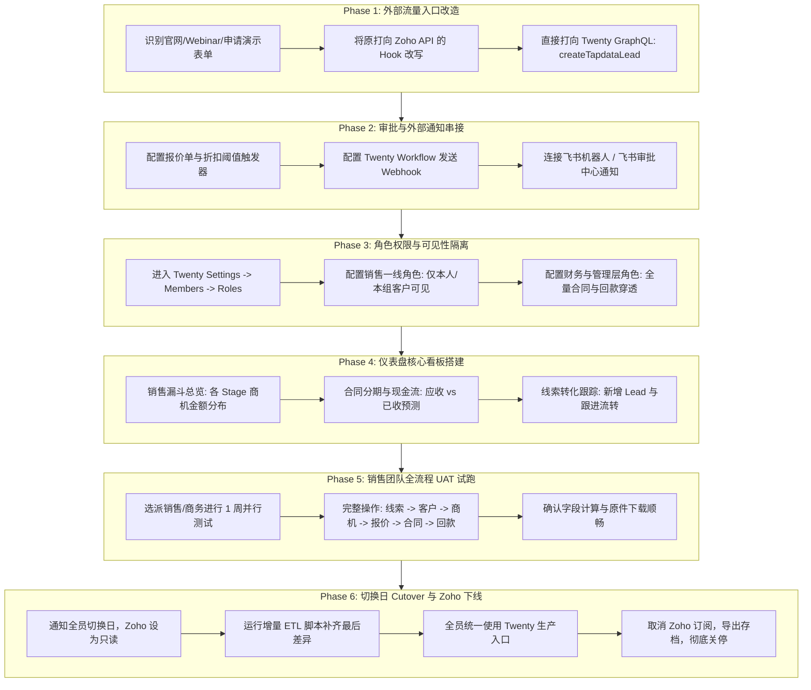

# Tapdata 从 Zoho CRM 彻底弃用并切换至 Twenty CRM 实施路线图 (Cutover Spec)

> **版本**：v1.0.0  
> **制定日期**：2026-10-16  
> **目标**：在全量历史数据与核心财务金额已 100% 精确迁移至 Twenty CRM 的基础上，制定系统完全弃用 Zoho CRM、全员正式切换上线所需的完整技术规格与执行步骤。

---

## 一、 当前数据迁移完成现状审计 (Baseline)

截至 2026-10-16，所有历史核心业务数据已从本地数据库全量迁移至部署在 `192.168.1.39:8091 (局域网) / 100.85.174.97:8091 (Tailscale)` 的 Twenty CRM 生产工作区，两端校验结果如下：

### 1. 业务对象行数对账

| 业务实体 (Entity) | EspoCRM 本地源库 | Twenty CRM 目标库 | 对账状态 | 说明 |
| :--- | :---: | :---: | :---: | :--- |
| **客户联系人 (People)** | **1,539** | **1,539** | **✓ MATCH** | 100% 完整，手机号规范化清洗 |
| **销售线索 (Leads)** | **13,304** | **13,304** | **✓ MATCH** | 落地至 `tapdataLead`，带原 Zoho/Espo 锚点 |
| **跟进任务 (Tasks)** | **2,475** | **2,475** | **✓ MATCH** | 966 条任务关联到对应客户与联系人 Target |
| **产品库 (Products)** | **90** | **90** | **✓ MATCH** | LDP 与 MDB 全系列 SKU 与目录单价 |
| **商业报价单 (Quotes)** | **212** | **212** | **✓ MATCH** | 关联客户与明细项 |
| **报价明细 (Quote Items)** | **402** | **402** | **✓ MATCH** | 折扣率、行小计金额 |
| **销售合同 (Contracts)** | **292** | **292** | **✓ MATCH** | 汇率锚定、履约周期、分期方式 |
| **合同产品明细 (Contract Items)** | **324** | **324** | **✓ MATCH** | 购买节点数、服务项 |
| **分期结算计划 (Installments)** | **435** | **435** | **✓ MATCH** | 合同 1~4 期约定付款日期与金额 |
| **实际到账回款 (Receipts)** | **329** | **329** | **✓ MATCH** | 落地至 `tapdataReceipt`，发票与收款流水 |
| **合同盖章件/附件 (Attachments)** | **107** | **107** | **✓ MATCH** | PDF/Word 原件挂载于对应合同详情页 |
| **工作区成员 (Members)** | **29** | **29** | **✓ MATCH** | 初始激活，负责人字段自动绑定 |
| **客户公司 (Companies)** | 1,437 | 1,404 | **覆盖全部有效主体** | 33 个差异为完全同名分公司合并 |
| **商业机会 (Opportunities)** | 916 | 897 | **覆盖全部业务商机** | 19 个差异为名称缺失/空项去重 |

### 2. 核心财务金额分币种 100% 精确对账

| 财务核算科目 | 结算币种 | 源系统金额合计 | Twenty 目标系统金额合计 | 校验状态 |
| :--- | :---: | :---: | :---: | :---: |
| **销售合同签约总金额** | **CNY (人民币)** | **¥81,246,144.65** | **¥81,246,144.65** | **✓ 分文不差** |
| | **HKD (港币)** | **HK$4,209,382.00** | **HK$4,209,382.00** | **✓ 分文不差** |
| | **USD (美元)** | **$1,113,494.00** | **$1,113,494.00** | **✓ 分文不差** |
| **实际已回款到账总额** | **CNY (人民币)** | **¥58,281,999.40** | **¥58,281,999.40** | **✓ 分文不差** |
| | **HKD (港币)** | **HK$1,072,494.00** | **HK$1,072,494.00** | **✓ 分文不差** |
| | **USD (美元)** | **$324,721.00** | **$324,721.00** | **✓ 分文不差** |

---

## 二、 彻底弃用 Zoho CRM 全流程路线图

从当前数据就绪状态，到完全停用并下线 Zoho CRM 账号订阅，执行流程分为六大阶段：



---

## 三、 六大实施阶段规格细化与执行规范

### Phase 1: 外部线索流量入口改造

* **背景**：Tapdata 官网（“申请试用”、“预约演示”页面）、线下展会表单、线上 Webinar 登记如果直接对接 Zoho Web-to-Lead，新线索仍会流入 Zoho。
* **技术动作**：
  1. 梳理当前直接写入 Zoho API (`zohoapis.com.cn/crm/v8/Leads`) 的前端服务或脚本。
  2. 统一替换为调用 Twenty 服务端 GraphQL 接口：
     ```graphql
     mutation CreateInboundLead($data: TapdataLeadCreateInput!) {
       createTapdataLead(data: $data) {
         id
         name
         email
         phone
         accountName
       }
     }
     ```
  3. 认证方式采用固定受限 API Key（仅具备 `tapdataLead:create` 权限）。
* **验收标准**：在官网提交一条测试预约，Twenty 的 `Tapdata 线索` 列表在 1 秒内实时出现该记录。

---

### Phase 2: 审批流程与飞书/企微通知联动

* **背景**：Zoho 中原有的报价单折扣审批流（草稿 $\rightarrow$ 审批中 $\rightarrow$ 已批准），以及签约成功后的全员喜报通知。
* **技术动作**：
  1. **报价审批**：
     * 利用 Twenty 原生 Workflow 模块，添加 Trigger（当 `tapdataQuote.discountPercentage > 20` 或报价金额达到特定阈值）。
     * 执行 Action：发送 HTTP Request（Webhook）至 Tapdata 内部集成网关或飞书多维表格/审批机器人。
  2. **合同签约喜报与履约通知**：
     * Trigger：当 `tapdataContract.status` 更新为 `SIGNED` 或 `EXECUTING`。
     * Action：触发飞书群 Webhook，推送合同客户、签约金额、负责销售与履约起始日期。
* **验收标准**：销售在 Twenty 提交大额报价单时，飞书审批群在 3 秒内收到带有审批卡片的通知。

---

### Phase 3: 角色权限微调与数据安全隔离

* **背景**：已初始化的 29 名成员默认分配了工作区通用权限，上线前需按合规要求落地权限边界。
* **配置清单**（进入 `Settings -> Members -> Roles`）：
  1. **销售代表角色 (Sales Representative)**：
     * `Company` / `Person` / `Opportunity` / `TapdataLead`：读取与修改限制为 `Created By / Owner is Self`（仅看自己的跟进记录）。
     * 禁用客户、合同批量导出权限。
  2. **销售总监 / 商务负责人 (Sales Director / Business Ops)**：
     * 全公司客户、商机、报价单完全穿透，具备修改与指派权。
  3. **财务负责人 (Finance)**：
     * `TapdataContract` 与 `TapdataReceipt` 完全穿透；对回款流水有核销标记权。
* **验收标准**：销售 A 登录系统后，在客户列表和商机看板中无法检索到销售 B 标记为私有的客户记录。

---

### Phase 4: 仪表盘核心看板搭建

* **配置位置**：Twenty 前端 `Dashboards` 模块（原生支持无代码拖拽与图表组合，无需第三方付费套件）。
* **推荐交付 3 块生产看板**：
  1. **销售战报与漏斗看板 (Pipeline Funnel)**：
     * 组件 1（漏斗图）：按 `Opportunity.stage`（`NEW` $\rightarrow$ `MEETING` $\rightarrow$ `PROPOSAL` $\rightarrow$ `NEGOTIATION` $\rightarrow$ `CUSTOMER` $\rightarrow$ `LOST`）展示项目数与金额分布。
     * 组件 2（数字卡片）：本季度预计成交金额（Expected Revenue 求和）与回款完成率。
  2. **合同结算与现金流预警看板 (Cash Flow & Receivables)**：
     * 组件 1（柱状图/折线图）：按签约月份统计合同签约额（`amountCny`）。
     * 组件 2（堆叠柱状图）：按季度统计实际到账金额（`Receipt.amountCny`）对比剩余应收账款（`Contract.receivable`）。
  3. **线索转化看板 (Lead Conversion)**：
     * 组件 1：按 `TapdataLead.status`（新线索 / 处理中 / 已回收）统计每日/每周新增分布。
     * 组件 2：按线索来源（`source`）分析转化率最高渠道。
* **验收标准**：管理层打开首页仪表盘，可直接一目了然查看全公司实时现金流与当月漏斗。

---

### Phase 5: 业务全流程 UAT 试跑

* **试跑周期**：建议安排 1 周（5 个工作日）。
* **试跑角色**：选定 1 位一线销售、1 位技术支持 (SE)、1 位商务合同管理员。
* **端到端必跑用例清单**：
  $$\begin{aligned}
  \text{Step 1: } & \text{录入/导入一条新线索 (Lead)} \\
  \text{Step 2: } & \text{跟进并转化为正式客户公司 (Company) 与联系人 (Person)} \\
  \text{Step 3: } & \text{建立新商机 (Opportunity)，设定预期签约日期与金额} \\
  \text{Step 4: } & \text{选择产品库 (Product) 制作正式报价单 (Quote)，确认折扣与明细} \\
  \text{Step 5: } & \text{商机赢单，生成正式销售合同 (Contract)} \\
  \text{Step 6: } & \text{设定 1~4 期分期计划 (Installments)，录入首期回款单 (Receipt)} \\
  \text{Step 7: } & \text{上传盖章版合同扫描 PDF，检查详情页预览与下载}
  \end{aligned}$$
* **验收标准**：试跑人员确认各项字段计算逻辑正确，无阻断性交互 Bug。

---

### Phase 6: 切换日协议 (Cutover Protocol) 与 Zoho 下线

* **T-2 天（通知发布）**：发布全员邮件/公告，指定“周五 18:00 为 Zoho 录入截止点”。
* **T-0 日 18:00（数据封板）**：
  1. 将 Zoho 所有用户的角色设为只读（Read Only）或修改密码，防止新数据被写入旧系统。
  2. 运行增量同步命令，将截止时间前最后产生的新线索、新合同差额补录到 Twenty：
     ```bash
     cd ~/app/espocrm-fork
     # 运行幂等增量补跑脚本（基于 espoId / zohoId 自动判重并只插入差额）
     python3 scripts/migration/import_to_twenty_full.py
     python3 scripts/migration/upload_all_contract_attachments.py
     ```
  3. 重新运行最终对账脚本，确认行数与金额再次完全对齐：
     ```bash
     python3 /tmp/reconcile_all.py
     ```
* **T+1 日（周一早晨 09:00 全员正式切入）**：
  1. 全员正式只登录使用 Twenty：`http://192.168.1.39:8091/ (局域网) 或 http://100.85.174.97:8091/ (Tailscale)`。
  2. 提供 2 周的 Zoho 只读归档期供员工查验。
  3. 2 周后执行 Zoho 历史完整数据库备份导出，关停 Zoho 商业订阅，彻底实现成本节省与系统自主可控。

---

## 四、 核心运维资产与脚本清单

| 资产文件路径 | 类型 | 用途说明 |
| :--- | :---: | :--- |
| `scripts/migration/export-espo-ndjson.sh` | Bash | 从本地 MySQL 直出 23 张表 NDJSON 镜像（零外部网络） |
| `scripts/migration/import_to_twenty_full.py` | Python | 全量 GraphQL 导入脚本（含手机号智能清洗、防重域名前缀检查、批量重试） |
| `scripts/migration/upload_all_contract_attachments.py` | Python | 107 份已盖章合同 PDF/Word 原件自动挂载上传脚本 |
| `scripts/migration/finish_tasks_and_gap_fill.py` | Python | 任务目标挂靠与重名公司/商机数据补平脚本 |
| `~/app/twenty-deploy/user_map.json` | JSON | 29 名员工 Espo User ID $\leftrightarrow$ Twenty WorkspaceMemberId 映射表 |
| `~/app/twenty-deploy/id_map.json` | JSON | 全量客户、商机、合同、报价、明细跨系统 UUID 映射字典 |
| `~/app/twenty-deploy/spike-secrets.env` | Config | 生产环境 Admin API Key 与管理员登录凭据存储 |
